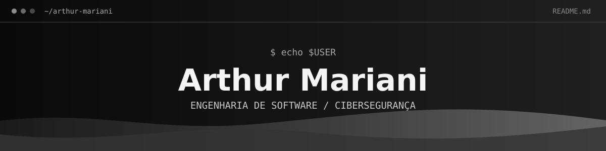

  

   
   

  

 

## Sobre mim

Atualmente sou graduando em Engenharia de Software. Gosto de entender como sistemas funcionam e de construir soluções claras, com atenção à qualidade do código e ao comportamento em condições adversas.

## Aprendendo agora

Estou aprofundando meus estudos em **Rust** e aplicando **SQLite**, **Linux** e **GitHub Actions** em um projeto local ligado à segurança de software. Também estou explorando práticas de **DevSecOps**, como testes automatizados, análise estática e verificação de dependências.

## Tecnologias e ferramentas

**Linguagens** 

**Web e APIs** 

**Ferramentas** 

**Dados** 

 

  

